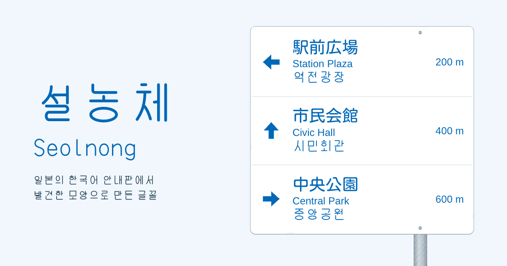

# 설농체 · Seolnong

일본의 한국어 안내판에서 발견한 글자 모양을 바탕으로 만든 한글 글꼴입니다. ‘ト’와 닮은 ㅏ와 낮고 옆으로 퍼지는 받침이 특징입니다. 간판, 제목, 짧은 문구에 어울립니다.

[글자 써 보기](https://dolsup.github.io/seolnong/) · [설농체 1.001 내려받기 (ZIP)](https://github.com/dolsup/seolnong/raw/refs/heads/main/downloads/Seolnong-1.001.zip) · [이용 안내](https://dolsup.github.io/seolnong/guide.html)



## 사용하기

ZIP을 풀고 `Seolnong-Regular.ttf`를 설치하면 글꼴 목록에서 **설농체** 또는 **Seolnong**을 선택할 수 있습니다. Regular 한 굵기이며 현대 한글 11,172자, 현대 조합 자모와 호환 자모, 기본 영문·숫자·기호를 지원합니다. 한자·일본어·옛한글에는 다른 글꼴을 함께 사용하세요.

ㅎ·ㅊ의 꼭지는 기본적으로 가로입니다. OpenType 스타일 세트 **Upright Caps (`ss01`)**를 켜면 두 자모의 꼭지가 세로로 바뀝니다.

### 웹에서 쓰기

ZIP에 들어 있는 `Seolnong-Regular.woff2`를 사이트에 올리고 CSS에서 불러오세요.

```css
@font-face {
  font-family: "Seolnong";
  src: url("./Seolnong-Regular.woff2") format("woff2");
  font-weight: 400;
  font-style: normal;
  font-display: swap;
}

.sign {
  font-family: "Seolnong", sans-serif;
  font-synthesis: none;
  font-feature-settings: "ss01" 1;
}
```

위 예시는 세로 꼭지를 사용합니다. 가로 꼭지를 쓰려면 `"ss01" 0`으로 지정하세요.

## 라이선스

설농체와 폰트 제작 소스는 [SIL Open Font License 1.1](OFL.txt)로 배포합니다. 개인·상업 이용, 임베딩, 수정과 재배포가 가능합니다. 재배포 시 저작권 고지와 라이선스 전문을 함께 제공하세요. 폰트 단독 판매는 금지됩니다.

소개 페이지에 쓰인 Kosugi Maru와 Arimo의 출처와 라이선스는 [별도 고지](licenses/README.md)에서 확인할 수 있습니다.
